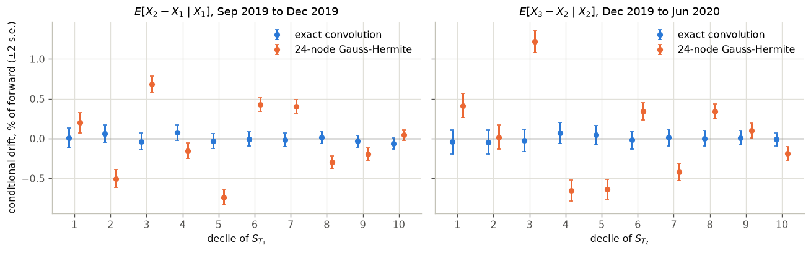
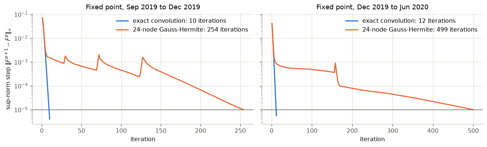
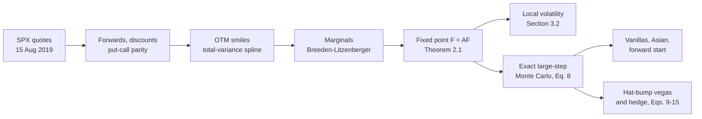
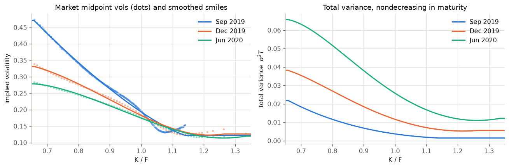
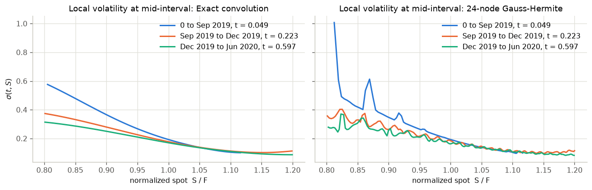
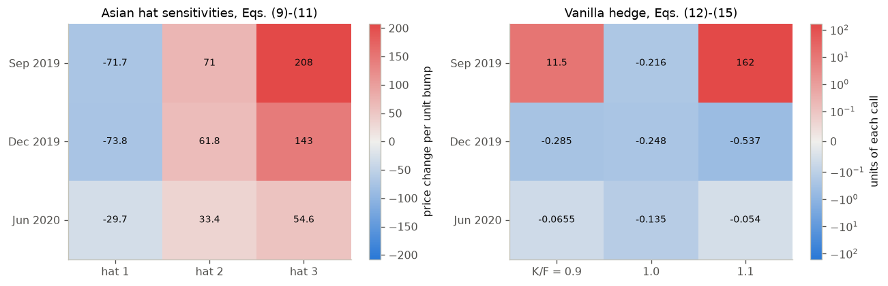
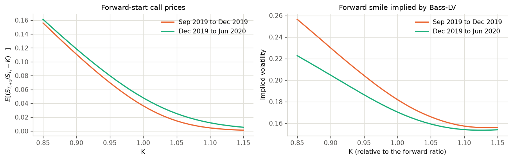

# bass-lv-calibration

[](https://github.com/AlphaShk/bass-lv-calibration/actions/workflows/ci.yml)

**Bass local volatility on real SPX options: calibrate a martingale to three expiries by a fixed
point, simulate it exactly, then price and vega-hedge a path-dependent option.**

A tested Python replication of A. Conze and P. Henry-Labordère, *Bass Construction with
Multi-Marginals: Lightspeed Computation in a New Local Volatility Model* (2021,
[SSRN 3853085](https://ssrn.com/abstract=3853085)), run on the SPX option chain at the close of
15 August 2019. The model is a martingale whose law at each listed expiry is a prescribed
marginal (here read off the smoothed SPX smile); it is simulated with one Gaussian draw per
expiry and no time stepping. It started as an MSc reading project at the University of Vienna
(summer 2026).

- **End to end.** Put-call-parity forwards, OTM smiles, Breeden-Litzenberger marginals, the
  Theorem 2.1 fixed point, local volatility, exact large-step Monte Carlo, Asian and
  forward-start pricing, hat-bump vega Greeks (Eqs. 9-15) with a nine-call vega hedge, and the
  Bass2 general-kernel operator (Theorem 6.1).
- **Exact heat-kernel convolution.** The paper suggests Gauss-Hermite quadrature for the
  convolutions (Section 3.4.1); my first implementation used 24 nodes. On the kinked
  piecewise-linear maps produced by this spline-smoothed SPX smile, that broke the martingale
  property (conditional drift up to 1.2% of the forward, max |z| = 17.8) and slowed the fixed
  point to 254 and 499 iterations. Convolving the piecewise-linear interpolant in closed form
  restores it (max |z| = 1.8) and converges in 10 and 12.
- **Greeks checked against bump-and-revalue.** The largest deviation is 0.2% of the largest
  sensitivity for the pathwise Asian Greeks and 1.3% for the semi-analytic call Greeks; with
  the 24-node quadrature the call Greeks were off by up to 31.5%.
- **55 tests on synthetic inputs**, including Black-Scholes recovery for lognormal marginals
  (Remark 2.6), run in CI on Python 3.12.



*Martingale check, 400,000 paths: mean increment of the normalized spot by decile of the previous
fixing (±2 s.e.). With 24-node Gauss-Hermite quadrature the drift reaches 1.2% of the forward
(max |z| = 17.8); with the exact convolution it stays within noise (max |z| = 1.8).*

## Results

One historical snapshot: SPX close of 15 Aug 2019 (spot 2847.60), expiries Sep 2019, Dec 2019
and Jun 2020. Monte Carlo at fixed seeds; ± is one standard error. Everything comes from
[`notebooks/bass_lv_replication.ipynb`](notebooks/bass_lv_replication.ipynb).

| Check | Exact convolution (default) | 24-node Gauss-Hermite (paper's suggestion, first implementation) |
|---|---|---|
| Fixed point: iterations to a 1e-5 sup-norm step (two intervals) | 10 and 12 | 254 and 499 |
| 60,000-path Monte Carlo repricing of 9 calls: max abs error (forward-normalized) | 1.89e-4 (≤ 1.61 s.e.) | 2.53e-4 (≤ 1.61 s.e.) |
| 3-fixing ATM Asian call, full smile (index points) | 106.02 ± 0.51 | 105.86 ± 0.51 |
| Same Asian, ATM-lognormal marginals | 106.53 ± 0.68 | 106.53 ± 0.68 |
| Paired difference, common random numbers | -0.51 ± 0.23 | -0.66 ± 0.24 |
| Martingale check: max abs z of the conditional drift (20 bins, 400,000 paths) | 1.8 | 17.8 |
| 9x9 vanilla vega matrix: rank, condition number | 9, 1.41e4 | 9, 1.30e4 * |
| Greeks vs bump-and-revalue, max deviation relative to the largest Greek: Asian / calls | 0.2% / 1.3% | 0.8% / 31.5% |

\* Computed here with `method="gauss-hermite"`. The vega-matrix and hedge figures of that
column include one later fix: the strike integral of the call sensitivities now starts at the
strike instead of the next grid node.

Two consistency checks hold by construction, so they are not evidence on their own. The
nine-call hedge is a square 9x9 solve: the largest hat sensitivity left after hedging is
1.6e-11 (3.9e-11 with Gauss-Hermite). With Brownian kernels the Bass2 operator (Theorem 6.1)
reduces to Eq. (2), so its residual is the Theorem 2.1 one: 1.3e-6 on Sep to Dec 2019 (9.5e-6
with Gauss-Hermite). No non-Brownian kernel is calibrated.

Inputs and fit, per expiry:

| Expiry | T (years) | OTM quotes kept | Smoothed smile vs market mids, IV RMSE | Calibrated marginals vs market mids, IV RMSE (max) | Median bid-ask half-spread |
|---|---|---|---|---|---|
| 20 Sep 2019 | 0.0986 | 246 | 96.5 bp | 113.3 bp (284.0 bp) | 16.3 bp |
| 20 Dec 2019 | 0.3479 | 65 | 65.2 bp | 65.1 bp (134.0 bp) | 10.2 bp |
| 19 Jun 2020 | 0.8466 | 67 | 35.9 bp | 37.6 bp (104.5 bp) | 11.4 bp |

The model calibrates exactly to the Breeden-Litzenberger marginals of the smoothed smile (after
clipping where it has negative butterflies, and rescaling to mean one), not to the raw quotes.
Its vanilla prices therefore miss market midpoints by the "calibrated marginals" errors above,
up to 284 bp of implied volatility on one Sep 2019 quote (see [Limitations](#limitations)).



## Method

The model is a martingale $S_t = f(t, W_t)$. Inside each interval $[T_i, T_{i+1}]$ the latent
state $W$ moves like a Brownian motion and $f$ solves the backward heat equation; the
construction picks $f$ so that $S_{T_i}\sim\mu_i$ at every listed expiry. With the heat kernel
$K_t * h(w) = \mathbb E[h(w + \sqrt{t} Z)]$:

- **First interval** (Bass's construction): $f(T_1, w) = F_{\mu_1}^{-1}\big(N(w/\sqrt{T_1})\big)$ and $f(t,\cdot) = K_{T_1 - t} * f(T_1,\cdot)$.
- **Later intervals** (Theorem 2.1): the law $F$ of $W_{T_i}$ is the fixed point of

  ```math
  \mathcal A F = F_{\mu_i}\circ\Big(K_\Delta * \big(F_{\mu_{i+1}}^{-1}\circ (K_\Delta * F)\big)\Big),
  \qquad F = \mathcal A F,\qquad \Delta = T_{i+1} - T_i,
  ```

  found by Picard iteration from the linearized solution (Eq. 26) and recentered to
  $F(0) = 1/2$ (Remark 2.3). The interval is then $f(t,\cdot) = K_{T_{i+1}-t} * g_i$ with
  $g_i = F_{\mu_{i+1}}^{-1}\circ(K_\Delta * F)$ (Eq. 3).
- **Market dates** (Eq. 8): the asset value is kept and the latent state is reset,
  $W_{T_i} = f_{[T_i, T_{i+1}]}(T_i,\cdot)^{-1}(S_{T_i})$. A path therefore needs one Gaussian
  draw per interval and no time stepping.
- **Local volatility** (Section 3.2): $\sigma(t, S) = \partial_w \log f\big(t, f^{-1}(t, S)\big)$.
- **Vega Greeks** (Section 5): bump each $g_i$ by triangular hats $\varepsilon h_i^l$ (Eq. 9),
  differentiate the exotic pathwise with a backward sweep over the resets (Eqs. 10-11),
  propagate the bumps to the marginal CDFs by forward induction (Eqs. 12-15), and solve for
  the vanilla weights $\omega$ with $\sum_k \omega_k \partial C_k / \partial\varepsilon_{il} = -\partial V / \partial\varepsilon_{il}$ for every hat.
- **Bass2** (Theorem 6.1): a general reference kernel only changes the two convolutions,
  $\mathcal A^X F = F_{\mu_1}\circ\big(K^{-X} * (F_{\mu_2}^{-1}\circ(K^X * F))\big)$.





### Numerical note: why the convolution is exact

Every map is stored on a latent grid and read between nodes by linear interpolation, which is
also how the Monte Carlo evaluates it. The default `method="exact"` convolves that
piecewise-linear interpolant with the Gaussian in closed form, so the start map
$h = K_\Delta * g$ is exactly the conditional expectation the simulation sees.

The paper suggests Gauss-Hermite quadrature for these convolutions (Section 3.4.1), and the
first implementation used 24 nodes, which is accurate for smooth functions. The terminal maps
here are not smooth: the Breeden-Litzenberger CDF is clipped where the smoothed smile has
negative butterflies, and the quantile function is flat beyond its probability grid. The
quadrature error in $h$ then reaches about $10^{-2}$ of the forward. The marginals are still
matched, because the fixed point uses the same $h$, but
$\mathbb E[S_{T_{i+1}}\mid S_{T_i}]\neq S_{T_i}$, the local volatility turns noisy, and the
semi-analytic call Greeks describe a different model from the one being simulated. The clipping
kinks come from this repository's own spline fit, so an arbitrage-free SVI/SSVI fit would also
reduce them. The quadrature is kept as `method="gauss-hermite"` to reproduce the first
implementation's numbers.







## Quickstart

```bash
git clone https://github.com/AlphaShk/bass-lv-calibration.git
cd bass-lv-calibration
python3.12 -m venv .venv && source .venv/bin/activate
pip install -r requirements-dev.txt && pip install --no-deps -e .
pytest -q                     # synthetic tests, no market data needed
```

The package on its own, with synthetic marginals:

```python
import numpy as np
import bass_lv as bl

T = np.array([0.25, 0.5, 1.0])
marginals = [bl.lognormal_marginal(0.2**2 * t) for t in T]  # mean-one laws, one per expiry
model = bl.calibrate(marginals, T)                           # one fixed point per interval
X = bl.simulate_market_dates(model, n=100_000, seed=1)       # S_{T_i} / F_i, exact large steps
print(bl.repricing_table(X, marginals))
```

To rerun the SPX notebooks, get the data (next section), then:

```bash
python scripts/prepare_data.py path/to/Sample_L2_20190815.zip   # writes data/spx_otm_quotes_2019-08-15.csv
pip install -e ".[notebooks]"                                    # matplotlib, JupyterLab, ipykernel
jupyter lab notebooks/bass_lv_replication.ipynb
python scripts/export_figures.py                                 # refresh docs/img from the executed notebook
```

Headless rerun: `jupyter nbconvert --to notebook --execute --inplace notebooks/bass_lv_replication.ipynb`.

`requirements.txt` pins the runtime dependencies (NumPy, SciPy, pandas); `requirements-dev.txt`
adds pytest and ruff and is what CI installs. Both are compiled with uv for Python 3.12.

## Data

The quotes are HistoricalOptionData's free end-of-day sample. It is the vendor's data and is
not redistributed here; `data/` is git-ignored.

1. On [historicaloptiondata.com/sample-files](https://historicaloptiondata.com/sample-files/)
   download the Level 2 end-of-day daily sample, `Sample_L2_20190815.zip` (about 28 MB).
2. Run `python scripts/prepare_data.py path/to/Sample_L2_20190815.zip`. The script
   - keeps the standard SPX root (not SPXW) quoted at the 16:00 close of
     15 Aug 2019, spot 2847.60, for the expiries 20 Sep 2019, 20 Dec 2019 and 19 Jun 2020:
     1,026 calls and puts, checked against a SHA-256 of the subset used for the results above;
   - infers the discount factor and forward of each expiry by regressing call-minus-put
     midpoints on strike;
   - keeps one out-of-the-money quote per strike (puts below the forward, calls above) with
     0.65 < K/F < 1.35, a positive bid, a spread of at most max(10, mid/2) index points and a
     call-equivalent price strictly between intrinsic value and the discounted forward: 246, 65
     and 67 quotes;
   - writes `data/spx_otm_quotes_2019-08-15.csv` with Black implied volatilities of the midpoints.

Committed notebook outputs show aggregates and charts only, never quote rows.

## Repository structure

```text
src/bass_lv/
  heat.py          heat kernel: exact piecewise-linear convolution or Gauss-Hermite quadrature
  marginals.py     mean-one marginals as quantile functions, Breeden-Litzenberger
  market.py        Black formulas, put-call-parity forwards, OTM cleaning, total-variance spline
  calibration.py   classical interval, Eq. (26) initializer, Theorem 2.1 fixed point, local vol
  simulation.py    exact large-step Monte Carlo, repricing, Asian and forward-start payoffs,
                   martingale diagnostic
  greeks.py        hat bumps, pathwise adjoint (Eqs. 10-11), CDF sensitivities (Eqs. 12-15),
                   forward induction of the marginals, vega hedge
  bass2.py         general-kernel operator (Theorem 6.1)
  data.py          vendor sample to cleaned OTM quote file
notebooks/
  bass_lv_replication.ipynb   main notebook, executed, every section tied to the paper
  bass_lv_tutorial.ipynb      compact version: the fixed point in a dozen lines, ATM-lognormal marginals
scripts/           prepare_data.py, export_figures.py
tests/             pytest suite on synthetic inputs
docs/img/          figures exported from the main notebook
```

## Tests

`pytest -q` runs 55 tests in about 3 seconds, all on synthetic inputs:

- **Black-Scholes recovery (Remark 2.6):** with lognormal marginals of one volatility, the
  classical interval is geometric Brownian motion, the fixed point is the Gaussian law, local
  volatility is flat, and simulated returns, forward-start calls and the Asian price match
  Black-Scholes.
- **Martingale and mean one:** marginals have mean one; the Appendix identities hold; simulated
  paths show no conditional drift; the Gauss-Hermite variant fails the same test on a
  half-year interval.
- **Fixed point:** convergence on skewed (SVI-type) marginals, contraction, the same fixed point
  from both initializers, a warning when `max_iter` is reached first.
- **Monte Carlo:** vanilla repricing within 4 standard errors; payoff sanity bounds.
- **Heat kernel:** the exact convolution matches fine quadrature to 1e-7 on kinked maps;
  closed-form heat of a hat; semigroup property; chunked off-grid evaluation.
- **Greeks:** call sensitivities (Eqs. 12-15) against finite differences of the forward
  induction; Asian sensitivities (Eqs. 10-11) against bump-and-revalue with common random
  numbers; the hedge cancels every bump.
- **Bass2 and data:** the general operator with Brownian kernels equals Eq. (2); the data
  pipeline on a synthetic file in the vendor's layout, including the CLI.

## Limitations

Scope: a faithful replication on one snapshot, not a production calibrator.

- **One snapshot, three expiries, one underlying.** No time series and no out-of-sample test.
- **Smile fit.** A heavily smoothed spline in total variance (smoothing factor 2e-5 per quote),
  not an arbitrage-free parametrization such as SVI/SSVI. The model's marginals miss market
  midpoints by 37.6 to 113.3 bp RMSE (up to 284 bp on one Sep 2019 quote), several times the
  bid-ask half-spread, and the wings are held flat beyond the last quote.
- **Truncation.** Marginals live on the probability grid [1e-5, 1 - 1e-5] and the moneyness
  range [0.45, 1.8]; tails beyond that are cut.
- **Monte Carlo noise.** Prices are quoted at fixed seeds. The Asian hat sensitivities use
  30,000 paths, with standard errors of 0.9 to 4.2 index points per unit bump.
- **Hedge.** Nine calls against nine bumps is an exactly determined system with condition
  number 1.41e4, so the near-zero residual only reflects the linear solve. The weights are not
  robust (162 units of the Sep 2019 call at K/F = 1.1), and the hedge is not backtested.
- **Not reproduced from the paper:** the Dupire comparisons (Figure 2, Tables 1-2), the
  autocall, and the calibrations of Section 6.2 (future skew) and 6.3 (stochastic-volatility
  kernel). The snapshot has no inputs for the last two, so Section 6 stops at the operator,
  checked with Brownian kernels only.

## Citation

The method is the paper's:

```bibtex
@article{conze2021bass,
  author  = {Conze, Antoine and Henry-Labord{\`e}re, Pierre},
  title   = {Bass Construction with Multi-Marginals: Lightspeed Computation in a New Local Volatility Model},
  journal = {SSRN Electronic Journal},
  year    = {2021},
  doi     = {10.2139/ssrn.3853085},
  url     = {https://ssrn.com/abstract=3853085}
}
```

To cite this implementation:

```bibtex
@software{shkola2026basslv,
  author = {Shkola, Denys},
  title  = {bass-lv-calibration: Bass local volatility on SPX options},
  year   = {2026},
  url    = {https://github.com/AlphaShk/bass-lv-calibration}
}
```

## License

MIT, see [LICENSE](LICENSE). The paper is not included; read it on
[SSRN](https://ssrn.com/abstract=3853085). Market data is the vendor's and is not included.

Denys Shkola · [LinkedIn](https://www.linkedin.com/in/denysshkola) · [GitHub](https://github.com/AlphaShk)
